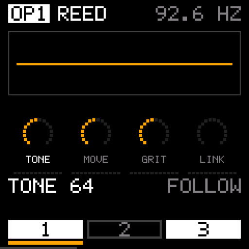

# BOURDON



BOURDON is a firmware for the M-VAVE FM-1 that makes it a drone instrument. It replaces the firmware of the FM-1.

<a href="https://thefirmwarehub.com/firmware/bourdon/"></a>

BOURDON is on [The Firmware Hub](https://thefirmwarehub.com/firmware/bourdon/), which can install it from the browser. The
guide, with the screens, is at [kevinsint.live/apps/bourdon](https://kevinsint.live/apps/bourdon/).

It has three voices. Each voice has a style that you choose, a free frequency (no notes, no keyboard), a few knobs
that you play, and a link to the voice before it. A mixer and a chain of effects (delay, reverb, compressor) come
after the voices.

BOURDON is not a product of M-VAVE, and M-VAVE does not support it.

## State

Version V0.38. This is early work. Until V0.33 its name was DR1.

- The six styles and the ranges of the knobs are a first estimate.
- The firmware saves the values only when you press `SAVE`. At power-on it starts with the values saved last, and
  all the voices muted: unmute them in the mixer (`GLO`). A save can be heard: the sound stops for a moment while the flash is written.
- It is tested on one FM-1 only, with the Puya P25Q80 flash.

## Before you install

**You install this at your own risk.** An install that goes wrong can leave an FM-1 that does not start. There is a
rescue tool (see "Back to the stock firmware"), but there is no warranty of any kind.

- BOURDON replaces the firmware that is on the FM-1. Your FM-1 is not an FM synthesizer while BOURDON is on it.
- BOURDON can replace itself, or go back to another firmware, only on an FM-1 with one of these two flash parts: Puya
  P25Q80 (the first units) or UC25HQ80 (newer units). On a different part, BOURDON refuses the update and only the
  rescue tool can replace it.
- What we tested (V0.34, the same firmware as V0.35 but for its identity, on one FM-1): an install over DR1 V0.33, the way back to M-VAVE's stock firmware V15, and
  an install over V15. Earlier versions were also installed over a firmware of the Felucca family.

## Install

You need a Mac or a Linux computer, a USB cable, Git and Python 3.12. (The installer's MIDI library has ready
packages for Python 3.12 and older only.)

1. Get this repository with its submodule. The installer is in the submodule.

   ```sh
   git clone --recurse-submodules https://github.com/kevinsint/bourdon.git
   cd bourdon
   ```

2. Make a Python environment with the installer's two libraries.

   ```sh
   python3.12 -m venv .venv
   .venv/bin/pip install -r requirements.txt
   ```

3. Download `sint_fm1_bourdon.fwsc` from the [latest release](https://github.com/kevinsint/bourdon/releases/latest) into
   this folder. Compare its SHA-256 with the one in the release notes.

   ```sh
   shasum -a 256 sint_fm1_bourdon.fwsc
   ```

4. Connect the FM-1 to the computer with the USB cable and turn it on. Close every program that uses MIDI.

5. Read what is on the FM-1 now, and write it down. You need it if you want to go back.

   ```sh
   .venv/bin/python bsp/tools/fm1_install.py --info
   ```

6. Install. The tool shows what it will do and asks you to confirm. Do not disconnect the FM-1 before it restarts.

   ```sh
   .venv/bin/python bsp/tools/fm1_install.py sint_fm1_bourdon.fwsc
   ```

After the restart the screen shows `OP1 FLOOR` and a frequency. The three voices are off: press the `OP1` key.

### Install a newer BOURDON over BOURDON

BOURDON has its own USB name, `SINT_BOURDON`, so tell the installer where to look:

```sh
.venv/bin/python bsp/tools/fm1_install.py sint_fm1_bourdon.fwsc --port SINT
```

`SINT` also finds an FM-1 with DR1 on it (the name of this firmware until V0.33). A Mac keeps the first MIDI name it
saw for a device: after a change from DR1, its MIDI port can still be `SINT_FM1_DR1`.

If an install was cut off, run the same command again: it continues.

## Back to the stock firmware

1. Download the official FM-1 firmware V15 (`FM-1.fwsc`) from M-VAVE (m-vave.com, Download, PC Firmware).
2. Install it with the same tool:

   ```sh
   .venv/bin/python bsp/tools/fm1_install.py FM-1.fwsc --port SINT
   ```

If the FM-1 does not start any more, use the rescue tool of the base: `bsp/tools/fm1_rescue.py`. Its instructions
are at the top of that file.

## How to play

The full list of the controls is in [pannel-description.md](pannel-description.md). The short form:

| Control | Use |
|---|---|
| `OP1`, `OP2`, `OP3` keys | A press selects the voice, on every page. In the mixer it selects its channel too. The voices always run: a voice is silenced by its mute in the mixer. |
| `SELECT` | Nothing on this page. With `LFO` held: the LFO. |
| `ALGORITHM` | Layer 1: STYLE, the voice's style, one a click: FLOOR, REED, GLASS, GROWL, TIDE, PULSE. The line under the dials shows its name. An LFO can move it. Layer 2: the kind of the voice's link, FOLLOW, THROUGH or FM. Layer 3: nothing. |
| `KNOB1` to `KNOB4` | Layer 1: TONE, SPEED, GRIT, LINK. SPEED is the speed of the style's own LFOs (not the twelve of the LFO page); an LFO of the LFO page can move it. Layer 2: `KNOB1` is FREQ, the voice's frequency; `KNOB2` is nothing; `KNOB3` is GAIN (the voice's level, the same as in the mixer) and, on a THROUGH voice, `KNOB4` is OWN. Layer 3: the band at the end of the voice: `KNOB1` LOW (the low cut), `KNOB2` POSITION (moves the two cuts together), `KNOB3` nothing, `KNOB4` HIGH (the high cut), 20 Hz to 20 kHz, 24 dB an octave each; the band's width is HIGH less LOW. At power-on the band is open. While you turn LOW, POSITION or HIGH, and for a second after, the screen shows the band's curve in place of the wave: in amber where the knobs put it, in grey as the LFOs move it now. An LFO can move each value that these four knobs hold, in the three layers. |
| FREQ | A very slow turn is the smallest step; a fast turn goes far, up to an octave for a quarter of a turn. With `OCT-` held: by notes. With `OCT+` held: by octaves. On a note, the screen shows the note's name. An LFO can move it. |
| White keys 1 to 3 (the three leftmost) | The layer in hand: layer 1, 2 or 3. The three keys are lit; the one in hand blinks. On the screen, at the left of the knobs, a small square for each layer: the amber one is the layer in hand, layer 1 at the top. |
| `OCT-` | Held: a knob snaps. Each click takes its value to the next of its bottom, its middle, its value at power-on and its top. |
| `GLO` | The end of the chain (EOC), on its module open last (the mixer, the first time), then play again. |
| `HOME` | Back to the play page of the selected OP, from any page. |
| `FX` | The next disruptor's page: NOISE, CHOP, RING, then the play page again. |
| `LFO` | Pressed and let go: the LFO bank's page; again: back. Held on the play page: the amounts of the bank's LFOs on the selected voice. |
| `MASTER` | The output level. |
| `SEL` | Held: the version and the processor's load. |
| `SAVE` | Saves all the values: the voices, the mixer, the effects, the disruptors, the LFOs and the tempo. The FM-1 starts with them at the next power-on, all the voices muted. Its light flickers for a second after a good save, and stays dark after a save that failed. |
| `EDIT` | Random: the selected voice gets a new STYLE, TONE, SPEED, GRIT and LINK, and new LFO amounts onto these five (two LFOs at most on each). Its frequency, its GAIN, its band and the twelve LFOs stay. There is no way back but the values saved last. |

**The links.** Each voice listens to the voice before it: OP2 to OP1, OP3 to OP2, OP1 to OP3. LINK sets how much.
With FOLLOW, the other voice's loudness opens this voice's filter. With THROUGH, the other voice's sound goes through
this voice's filter; OWN then sets how much of this voice's own oscillators is left, down to none. With FM, the other
voice's sound bends this voice's pitch: a slow voice makes it go up and down, a fast voice gives it a new colour.

**The disruptors.** Three sources that the three voices share. On each one's page, `KNOB1` to `KNOB3` are its own
values, `KNOB4` is how much of it the selected voice takes, and `ALGORITHM` is where that voice takes it: its sound,
its PITCH or its CUTOFF. A disruptor that no voice takes is OFF and uses no processor time.

- NOISE: RATE (how often it takes a new value: from a hiss down to slow steps), BITS (12 down to 1) and DUST (values
  left out: cracks). Into a voice's SOUND, it is added before the voice's filter.
- CHOP: a pulse. RATE (one in four seconds up to a buzz), WIDTH (how long each pulse is open) and SKIP (pulses left
  out at random). Into a voice's LEVEL, it cuts the voice between the pulses.
- RING: a tone of its own. FREQ, FOLD (the sine bent over on itself: clean to harsh) and DRIFT (its frequency
  wanders). Into a voice's LEVEL, it is a ring modulation: the voice's sound times the tone.

**The LFO bank.** Twelve LFOs for the whole instrument, and a clock. A short press of `LFO` opens their page. `SELECT`
shows an LFO. An LFO is a shape, steps that play or not, and a loop. `ALGORITHM` is its shape, one of 14: GATE,
RATCHET 2, RATCHET 4, SOFT GATE, TRIANGLE, TRAPEZOID, SINE, HUMP, EXP, SOFT EXP, LOG, SOFT LOG, RANDOM, SOFT RANDOM
(in layer 4: its RANGE, BOTH or UP). `OCT+` turns SYNC on or off. `PRESETS` is the clock's tempo, 10 to 300 BPM
(60 at power-on).

The white keys 1 to 4 (the four leftmost) choose the layer: what the four right knobs hold. They are lit, and the one in hand blinks. At the left of the knobs, the screen has a small square for each layer; the amber one is the layer in hand.

- WAVE: RATE, WIDTH, LEVEL and OFFSET. RATE is free, one cycle in 63 seconds up to 24.5 cycles a second; with SYNC,
  a ratio to the clock, 32 beats a cycle up to 16 cycles a beat. WIDTH is the shape's own value: how long a gate is
  up, where a triangle's top is, how long an envelope falls, how far the random heights go.
- STEPS: one cycle of the shape is one step. PROB is how often a step plays. STEPS, TRIGS and SHIFT make a Euclidean
  pattern: TRIGS of the STEPS play, as far from each other as possible. A step that does not play keeps the
  value the last played step ended on: the output does not jump.
- LOOP: the LFO starts again after LOOP beats (a free LFO: after LOOP cycles), and its random heights and steps are
  the same each time round. NAP and WAKE: it sleeps for NAP loops after WAKE loops. L SHIFT moves where that starts.
- Layer 4 (white key 4): the PHASE, the SLEW (how soft its moves are), PAD (empty steps at the pattern's end) and
  RAND (random trigs in the empty steps). `ALGORITHM` is the RANGE there. An LFO can move these four too.

To give an LFO to another LFO, hold `LFO` on the LFO page. Choose the source with `SELECT`, then turn a knob: its
amount on the value that knob holds, for the LFO on the screen. `PRESETS` is its amount on the tempo.

To give an LFO to a voice, hold `LFO` on the play page. Choose the LFO with `SELECT`, then turn a knob: `KNOB1` to
`KNOB4` are its amounts on TONE, SPEED, GRIT and LINK, `ALGORITHM` on STYLE, `PRESETS` on FREQ; in layer 2, `KNOB1` on FREQ, `KNOB3` on GAIN and `KNOB4` on OWN; in layer 3, on LOW, POSITION and HIGH (100 is an octave each way; on TONE, SPEED and GRIT, 100 is the knob's whole travel each way, and an LFO never takes the value past the knob's two ends; on STYLE, 100
is the whole list of styles each way, and the voice changes to the nearest style). 1 a click notch
by notch, up to 20 a click turned fast; with `OCT-` held, to the next of -100, -50, 0, 50, 100; below 0 the LFO moves the value upside down. The
amounts are the selected voice's. Each dial is a round knob with a line where you set it. When LFOs move the knob, an
amber arc on its ring shows the range they move it over, and a lit dot shows where the value is now. The arc is the
real range: an LFO that goes up only moves the value to one side of the line, and less LEVEL makes the arc shorter.
While you hold the key, the arc is cyan and shows the range of the chosen LFO alone. Under each dial, small marks show
the LFOs that move that knob.

**The end of the chain (EOC).** Its modules are in a row: the mixer (MIX), the delay, the reverb, the compressor.
`SELECT` moves along seven stops: MIX, MIX OP1, MIX OP2, MIX OP3, DLY, REV, COMP. On MIX with no channel, `KNOB1` to
`KNOB3` are the three levels. On a channel, the knobs are its LEVEL, PAN, SEND 1 (to the delay) and SEND 2 (to the
reverb), and `OCT+` changes its sends from PRE to POST. The mixer shows six channels: OP4 to OP6 are kept for later
voices. An OP key selects its channel. The white key at the left of each OP key (F, G, A) mutes its channel, or not:
the channel and its two sends fade out in about 0.3 s, and the voice still runs, so its links still hear it. A mute key is lit;
a muted voice's goes black for a moment every 2 s; on the screen, a muted channel's box under its number is red. At power-on all three are
muted. The mute keys work in all the modules of the end of the chain, not only in the mixer. Any button with no use mutes all three. On an effect, the four right knobs are its values. The delay
is silent until you turn its LVL up.

## Build from source

You need Docker, Git, `curl` and Python 3.12. The compile step runs in a Linux x86-64 container, because the chip
maker's toolchain is for that system only.

```sh
git clone --recurse-submodules https://github.com/kevinsint/bourdon.git
cd bourdon
scripts/setup.sh            # one time: downloads JieLi's toolchain and AC79 SDK, checks them by hash, makes .venv
scripts/build.sh            # makes build/sint_fm1_bourdon.fwsc
```

`scripts/setup.sh` puts the toolchain and the SDK in `~/.jieli`. They are not in this repository.

The tests:

```sh
tests/run_host_tests.sh     # on your computer: no FM-1, no toolchain
tests/build_test.sh         # builds the package and checks it
```

## Licence and credits

BOURDON is under the GNU General Public License, version 3 only (GPL-3.0-only): see [LICENSE](LICENSE). The versions up
to V0.27 were published under the Mozilla Public License 2.0, and those copies stay under it.

BOURDON is made by Kevin Sint: [kevinsint.live/apps/bourdon](https://kevinsint.live/apps/bourdon/).

- BOURDON is built on [felucca-bsp](https://github.com/hugelton/felucca-bsp) by Leo Kuroshita, Hügelton Instruments
  (MPL-2.0). It is the `bsp` submodule, used unchanged: the chip and board code, the update loader, the package
  builder and the installer.
- `tools/fm1img.py` and `tools/lz4blk.py` come from that family of projects (MPL-2.0; their authors are named in the
  files). `app/app.ld` is felucca-bsp's memory map with more RAM. These three files stay under the MPL-2.0: its text
  is in [LICENSES/MPL-2.0.txt](LICENSES/MPL-2.0.txt).
- A built package holds three files of JieLi's AC79 SDK, which is under the Apache License 2.0. Its text is in
  `bsp/LICENSES/Apache-2.0.txt` and goes with every release.
